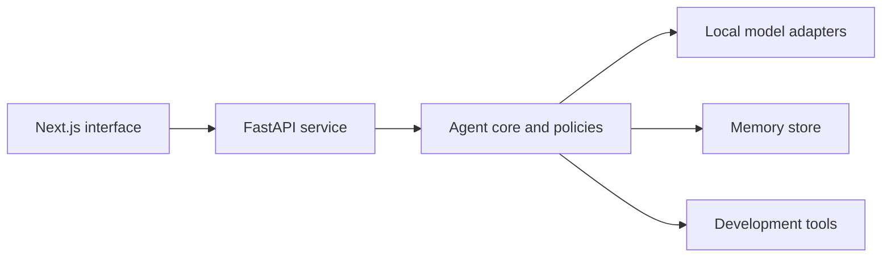

# Sagent

**Local-first AI agent for developer workflows on macOS.** A personal prototype exploring how local language models, persistent memory and explicitly controlled tools can support software development.

Created by **Santino Burkhardt**. The project combines agent design with concrete engineering concerns: workspace boundaries, change previews, tests and approvals.

## Problem and approach

An assistant that can modify code needs a clear boundary between proposing a change and applying it. Sagent combines a FastAPI service, a Next.js interface, local model adapters, SQLite-based memory and tools for workspace and development tasks. Its deterministic change and test paths use bounded policies; the newer agent loop is experimental and has a different security profile.



## Repository structure

- `apps/web/`: Next.js interface.
- `apps/agent-api/`: FastAPI service and API tests.
- `packages/agent-core/`: agent contracts, workflow and policy logic.
- `packages/memory/`: local memory component.
- `packages/tools/`: workspace, Git and test tools.
- `apps/desktop/`: Electron-based desktop shell.
- `docs/ARCHITECTURE.md`, `docs/SECURITY.md`, `docs/INDEX.md`: technical documentation and known boundaries.

## Run locally

Recommended environment: macOS, Node.js 22+, pnpm 11+, Python 3.12 and uv. Install dependencies from the repository root:

```bash
pnpm install
uv sync --dev
pnpm dev
```

The web interface runs at `http://127.0.0.1:3000`; the API at `http://127.0.0.1:8765`, with API documentation at `/docs`. For an optional macOS developer launcher, see `dev.command`. Copy `.env.example` to a local `.env` only when configuring the optional model and workspace settings; never commit credentials. External model runtimes such as Ollama or LM Studio need separate installation.

## Scope and limitations

Implemented paths include a proposal/approval workflow, code change previews, limited Git and test operations, local model adapters, model jobs, local persistence and an agent loop with tool events. Some cloud-provider UI and configuration is an offline preview; remote HTTP remains blocked in the documented policy.

**Security:** The experimental agent loop can invoke direct shell, writing and apply adapters. It has operational limits but no operating-system sandbox or universal external approval step. Use it only in trusted local checkouts after reading [the security documentation](docs/SECURITY.md). This is not a production agent service.

## Quality checks

```bash
pnpm check
pnpm build
uv run pytest -q
```

The repository also contains a GitHub Actions workflow for Python lint/tests and TypeScript typecheck/build. These commands describe the available checks; results depend on the local environment and installed model services.

## License

There is currently no repository-wide license. All rights reserved until an explicit license is added. This is a personal project, independent of the author's employer.
